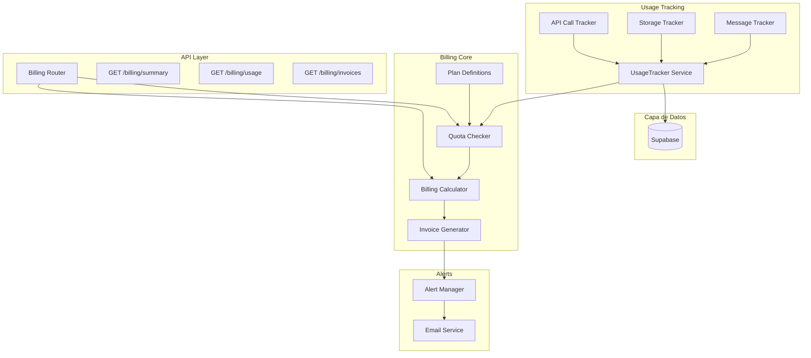
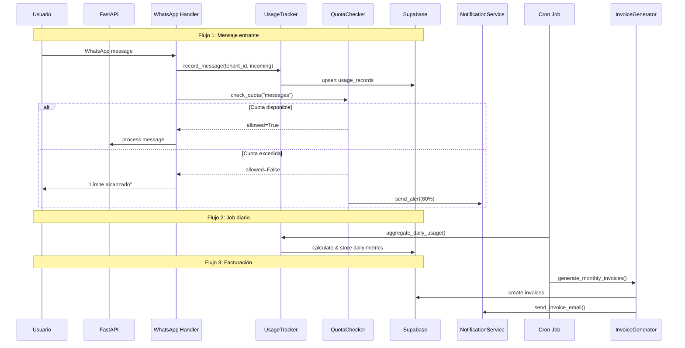

# SEMANA 7: BILLING & USAGE TRACKING

## 📋 Resumen del Sistema

Este documento detalla la implementación de un sistema completo de **facturación y seguimiento de uso** para la plataforma EstructuraAI. El sistema permite:

1. **Tracking de uso** - Monitorear mensajes, storage y llamadas API por tenant
2. **Planes y suscripciones** - Definir límites por plan (free, pro, enterprise)
3. **Verificación de cuotas** - Controlar límites en tiempo real
4. **Facturación** - Calcular costos mensuales, overages y generar facturas
5. **Alertas** - Notificar cuando el uso alcance 80% y 100% de los límites

---

## 📊 Arquitectura General



---

## 🗄️ Estructura de Base de Datos

### Tabla 1: `usage_records`
**Propósito:** Almacenar registros diarios de uso por tenant

```sql
CREATE TABLE usage_records (
    id UUID PRIMARY KEY DEFAULT gen_random_uuid(),
    tenant_id UUID NOT NULL REFERENCES tenants(id),
    record_date DATE NOT NULL,
    
    -- Métricas de mensajes
    messages_count INTEGER DEFAULT 0,
    messages_limit INTEGER DEFAULT 0,
    
    -- Métricas de storage (MB)
    storage_used_mb DECIMAL(10,2) DEFAULT 0,
    storage_limit_mb DECIMAL(10,2) DEFAULT 0,
    storage_breakdown JSONB DEFAULT '{}',
    
    -- Métricas de API calls
    api_calls_count INTEGER DEFAULT 0,
    api_calls_limit INTEGER DEFAULT 0,
    
    -- Metadatos
    created_at TIMESTAMPTZ DEFAULT NOW(),
    updated_at TIMESTAMPTZ DEFAULT NOW(),
    
    UNIQUE(tenant_id, record_date)
);

-- Índice para consultas rápidas por tenant y fecha
CREATE INDEX idx_usage_records_tenant_date 
    ON usage_records(tenant_id, record_date DESC);
```

### Tabla 2: `subscription_plans`
**Propósito:** Catálogo de planes disponibles

```sql
CREATE TABLE subscription_plans (
    id UUID PRIMARY KEY DEFAULT gen_random_uuid(),
    plan_key VARCHAR(50) UNIQUE NOT NULL, -- 'free', 'pro', 'enterprise'
    name VARCHAR(100) NOT NULL,
    description TEXT,
    is_active BOOLEAN DEFAULT true,
    
    -- Límites de mensajes
    messages_limit INTEGER DEFAULT 0,
    messages_limit_period VARCHAR(20) DEFAULT 'monthly', -- 'monthly', 'yearly'
    
    -- Límites de storage (MB)
    storage_limit_mb DECIMAL(10,2) DEFAULT 0,
    
    -- Límites de API calls
    api_calls_limit INTEGER DEFAULT 0,
    
    -- Límites de productos
    products_limit INTEGER DEFAULT 0,
    
    -- Límites de conversaciones
    conversations_limit INTEGER DEFAULT 0,
    
    -- Precios
    monthly_price DECIMAL(10,2) DEFAULT 0,
    yearly_price DECIMAL(10,2) DEFAULT 0,
    
    -- Features
    features JSONB DEFAULT '[]',
    
    created_at TIMESTAMPTZ DEFAULT NOW(),
    updated_at TIMESTAMPTZ DEFAULT NOW()
);

-- Planes por defecto
INSERT INTO subscription_plans (plan_key, name, description, messages_limit, storage_limit_mb, api_calls_limit, products_limit, conversations_limit, monthly_price, yearly_price, features) VALUES
('free', 'Free', 'Plan gratuito para pruebas', 100, 100, 500, 10, 50, 0, 0, '["basic_analytics", "whatsapp_basic"]'),
('pro', 'Pro', 'Plan profesional para negocios', 5000, 1000, 10000, 500, 1000, 29.99, 299.99, '["advanced_analytics", "whatsapp_full", "api_access", "priority_support"]'),
('enterprise', 'Enterprise', 'Plan empresarial sin límites', -1, -1, -1, -1, -1, 99.99, 999.99, '["advanced_analytics", "whatsapp_full", "api_access", "priority_support", "dedicated_agent", "custom_integrations"]');
```

### Tabla 3: `tenant_subscriptions`
**Propósito:** Suscripción activa de cada tenant

```sql
CREATE TABLE tenant_subscriptions (
    id UUID PRIMARY KEY DEFAULT gen_random_uuid(),
    tenant_id UUID NOT NULL REFERENCES tenants(id),
    plan_id UUID NOT NULL REFERENCES subscription_plans(id),
    
    -- Estado de suscripción
    status VARCHAR(20) DEFAULT 'active', -- 'active', 'trialing', 'past_due', 'canceled', 'paused'
    
    -- Fechas
    current_period_start DATE NOT NULL,
    current_period_end DATE NOT NULL,
    trial_start DATE,
    trial_end DATE,
    canceled_at TIMESTAMPTZ,
    pause_start DATE,
    pause_end DATE,
    
    -- Uso actual del ciclo
    messages_used_this_period INTEGER DEFAULT 0,
    storage_used_this_period DECIMAL(10,2) DEFAULT 0,
    api_calls_used_this_period INTEGER DEFAULT 0,
    
    -- Facturación
    billing_email VARCHAR(255),
    billing_cycle VARCHAR(20) DEFAULT 'monthly', -- 'monthly', 'yearly'
    next_billing_date DATE,
    last_invoice_id UUID,
    
    created_at TIMESTAMPTZ DEFAULT NOW(),
    updated_at TIMESTAMPTZ DEFAULT NOW()
);

CREATE INDEX idx_tenant_subscriptions_tenant 
    ON tenant_subscriptions(tenant_id);
CREATE INDEX idx_tenant_subscriptions_status 
    ON tenant_subscriptions(status);
```

### Tabla 4: `invoices`
**Propósito:** Registro de facturas generadas

```sql
CREATE TABLE invoices (
    id UUID PRIMARY KEY DEFAULT gen_random_uuid(),
    invoice_number VARCHAR(50) UNIQUE NOT NULL,
    tenant_id UUID NOT NULL REFERENCES tenants(id),
    subscription_id UUID NOT NULL REFERENCES tenant_subscriptions(id),
    
    -- Período facturado
    period_start DATE NOT NULL,
    period_end DATE NOT NULL,
    
    -- Montos
    subtotal DECIMAL(10,2) NOT NULL,
    tax_amount DECIMAL(10,2) DEFAULT 0,
    discount_amount DECIMAL(10,2) DEFAULT 0,
    total_amount DECIMAL(10,2) NOT NULL,
    currency VARCHAR(3) DEFAULT 'USD',
    
    -- Estado
    status VARCHAR(20) DEFAULT 'draft', -- 'draft', 'pending', 'paid', 'failed', 'cancelled'
    
    -- Detalle de uso
    usage_details JSONB DEFAULT '{}',
    line_items JSONB DEFAULT '[]',
    
    -- Pagos
    payment_method VARCHAR(50),
    payment_reference VARCHAR(255),
    paid_at TIMESTAMPTZ,
    
    -- Archivo
    pdf_url VARCHAR(500),
    
    created_at TIMESTAMPTZ DEFAULT NOW(),
    updated_at TIMESTAMPTZ DEFAULT NOW()
);

CREATE INDEX idx_invoices_tenant 
    ON invoices(tenant_id);
CREATE INDEX idx_invoices_status 
    ON invoices(status);
```

### Tabla 5: `usage_alerts`
**Propósito:** Historial de alertas de uso enviadas

```sql
CREATE TABLE usage_alerts (
    id UUID PRIMARY KEY DEFAULT gen_random_uuid(),
    tenant_id UUID NOT NULL REFERENCES tenants(id),
    
    -- Tipo de alerta
    alert_type VARCHAR(50) NOT NULL, -- 'messages', 'storage', 'api_calls', 'products'
    threshold_percent INTEGER NOT NULL, -- 80, 100, etc.
    
    -- Estado
    is_read BOOLEAN DEFAULT false,
    acknowledged_at TIMESTAMPTZ,
    
    -- Metadatos
    created_at TIMESTAMPTZ DEFAULT NOW()
);

CREATE INDEX idx_usage_alerts_tenant_unread 
    ON usage_alerts(tenant_id, is_read) 
    WHERE is_read = false;
```

---

## 📋 DETALLE DE LAS 19 TAREAS

### FASE 1: Usage Tracking (Tareas 1-5)

#### TAREA 1: Implementar tracker de mensajes por tenant
**Objetivo:** Contabilizar mensajes entrantes y salientes por tenant

**Implementación:**
```python
# src/services/usage_tracker.py

class MessageTracker:
    """Tracking de mensajes de WhatsApp"""
    
    def __init__(self, db: SupabaseClient):
        self.db = db
    
    def record_message(self, tenant_id: str, direction: str = "incoming"):
        """
        Registra un mensaje enviado o recibido
        
        Args:
            tenant_id: ID del tenant
            direction: 'incoming' | 'outgoing'
        """
        today = date.today()
        
        # Upsert del registro del día
        self.db.client.table('usage_records').upsert({
            'tenant_id': tenant_id,
            'record_date': today.isoformat(),
            'messages_count': 1  # Incremento handled por DB trigger o app
        }, on_conflict='tenant_id,record_date').execute()
    
    def get_message_usage(self, tenant_id: str, days: int = 30) -> dict:
        """Obtiene estadísticas de uso de mensajes"""
        result = self.db.client.table('usage_records').select(
            'record_date, messages_count, messages_limit'
        ).eq('tenant_id', tenant_id).execute()
        
        return {
            'total': sum(r['messages_count'] for r in result.data),
            'limit': result.data[0]['messages_limit'] if result.data else 0,
            'remaining': max(0, (result.data[0]['messages_limit'] or 0) - sum(r['messages_count'] for r in result.data))
        }
```

**Puntos de integración:**
- [`src/core/whatsapp_handler.py`](src/core/whatsapp_handler.py:215) → después de `handle_webhook()`, llamar `MessageTracker().record_message()`
- [`src/services/agent_orchestrator.py`](src/services/agent_orchestrator.py:112) → después de enviar respuesta, llamar `MessageTracker().record_message(..., direction="outgoing")`

---

#### TAREA 2: Implementar tracker de storage usado (BD + Qdrant)
**Objetivo:** Calcular storage usado en Supabase (PostgreSQL) y Qdrant (vectores)

**Implementación:**
```python
# src/services/usage_tracker.py

class StorageTracker:
    """Tracking de almacenamiento usado"""
    
    def __init__(self, db: SupabaseClient):
        self.db = db
    
    async def calculate_storage(self, tenant_id: str) -> dict:
        """
        Calcula el storage total usado por un tenant
        
        Returns:
            {
                'supabase_mb': 45.5,
                'qdrant_mb': 12.3,
                'total_mb': 57.8,
                'breakdown': {
                    'products_table': 20.0,
                    'conversations_table': 15.5,
                    'messages_table': 10.0,
                    'vectors': 12.3
                }
            }
        """
        breakdown = {}
        
        # 1. Storage en Supabase (productos)
        products_size = await self._get_table_size('products', tenant_id)
        breakdown['products'] = products_size
        
        # 2. Storage en Supabase (conversaciones)
        conv_size = await self._get_table_size('conversations', tenant_id)
        breakdown['conversations'] = conv_size
        
        # 3. Storage en Supabase (mensajes)
        msg_size = await self._get_table_size('messages', tenant_id)
        breakdown['messages'] = msg_size
        
        # 4. Storage en Qdrant (vectores)
        qdrant_size = await self._get_qdrant_size(tenant_id)
        breakdown['vectors'] = qdrant_size
        
        total = sum(breakdown.values())
        
        return {
            'supabase_mb': products_size + conv_size + msg_size,
            'qdrant_mb': qdrant_size,
            'total_mb': round(total, 2),
            'breakdown': breakdown
        }
    
    async def _get_table_size(self, table: str, tenant_id: str) -> float:
        """Obtiene tamaño de tabla para un tenant específico"""
        # Consulta a information_schema o pg_class
        query = f"""
            SELECT pg_total_relation_size('{table}') / 1024 / 1024 as size_mb
            FROM {table}
            WHERE tenant_id = '{tenant_id}'
            LIMIT 1
        """
        # Implementar con Raw SQL de Supabase
        pass
    
    async def _get_qdrant_size(self, tenant_id: str) -> float:
        """Obtiene tamaño de vectores en Qdrant"""
        # Qdrant no provee API de tamaño directamente
        # Estimación: count * vector_dim * 4 bytes
        from src.services.vector_service import get_qdrant_client
        client = get_qdrant_client()
        
        collection_name = f"products_{tenant_id}"
        try:
            info = client.get_collection(collection_name)
            vectors_count = info.vectors_count
            vector_dim = info.config.params.size
            return (vectors_count * vector_dim * 4) / (1024 * 1024)
        except:
            return 0.0
    
    def record_storage(self, tenant_id: str):
        """Registra el storage en la tabla de usage_records"""
        # Called by daily job
        pass
```

---

#### TAREA 3: Implementar tracker de llamadas a API
**Objetivo:** Contabilizar llamadas a endpoints externos (LLM, WhatsApp, etc.)

**Implementación:**
```python
# src/services/usage_tracker.py

class APICallTracker:
    """Tracking de llamadas a APIs externas"""
    
    def __init__(self, db: SupabaseClient):
        self.db = db
    
    def record_api_call(
        self, 
        tenant_id: str, 
        api_provider: str,  # 'openai', 'anthropic', 'whatsapp', 'qdrant'
        endpoint: str,
        tokens_used: int = 0
    ):
        """
        Registra una llamada a API externa
        
        Args:
            tenant_id: ID del tenant
            api_provider: Proveedor (openai, anthropic, whatsapp, qdrant)
            endpoint: Endpoint llamado
            tokens_used: Tokens consumidos (para LLMs)
        """
        today = date.today()
        
        # Registrar en logs o tabla de API calls
        self.db.client.table('api_call_logs').insert({
            'tenant_id': tenant_id,
            'api_provider': api_provider,
            'endpoint': endpoint,
            'tokens_used': tokens_used,
            'called_at': datetime.now(timezone.utc).isoformat()
        }).execute()
        
        # Incrementar contador del día
        self.db.client.table('usage_records').upsert({
            'tenant_id': tenant_id,
            'record_date': today.isoformat(),
            'api_calls_count': 1
        }, on_conflict='tenant_id,record_date').execute()
    
    def get_api_usage(self, tenant_id: str, days: int = 30) -> dict:
        """Obtiene estadísticas de uso de API"""
        # Aggregation query
        pass
```

**Puntos de integración:**
- [`src/services/llm_service.py`](src/services/llm_service.py:122) → después de cada llamada LLM, registrar con `APICallTracker().record_api_call()`
- [`src/core/whatsapp_handler.py`](src/core/whatsapp_handler.py:163) → después de `send_message()`, registrar

---

#### TAREA 4: Guardar registros de uso diarios en BD
**Objetivo:** Job diario que agrega y guarda el uso del día

**Implementación:**
```python
# scripts/jobs/aggregate_daily_usage.py

def aggregate_daily_usage():
    """
    Job diario que:
    1. Calcula uso de mensajes del día
    2. Calcula uso de storage
    3. Calcula uso de API calls
    4. Guarda en usage_records
    """
    from src.core.database import get_db
    from src.services.usage_tracker import MessageTracker, StorageTracker, APICallTracker
    
    db = get_db()
    message_tracker = MessageTracker(db)
    storage_tracker = StorageTracker(db)
    api_tracker = APICallTracker(db)
    
    # Obtener todos los tenants activos
    tenants = get_all_active_tenants()  # from tenant_service
    
    today = date.today()
    
    for tenant in tenants:
        tenant_id = tenant.tenant_id
        
        # 1. Mensajes (ya viene del webhook, solo agregar)
        messages_count = message_tracker.get_today_count(tenant_id)
        
        # 2. Storage (calcular hoy)
        storage = await storage_tracker.calculate_storage(tenant_id)
        
        # 3. API Calls (agregar del día)
        api_calls = api_tracker.get_today_count(tenant_id)
        
        # 4. Obtener límites del plan
        plan_limits = get_plan_limits(tenant_id)  # from subscription service
        
        # 5. Guardar registro
        db.client.table('usage_records').upsert({
            'tenant_id': tenant_id,
            'record_date': today.isoformat(),
            'messages_count': messages_count,
            'messages_limit': plan_limits['messages'],
            'storage_used_mb': storage['total_mb'],
            'storage_limit_mb': plan_limits['storage_mb'],
            'api_calls_count': api_calls,
            'api_calls_limit': plan_limits['api_calls'],
            'storage_breakdown': storage['breakdown']
        }, on_conflict='tenant_id,record_date').execute()
```

**Configuración CRON:** `0 0 * * *` (diario a medianoche)

---

#### TAREA 5: Tests de usage tracker (10 tests)
**Objetivo:** Coverage completo del sistema de tracking

**Tests a implementar:**
```python
# tests/test_usage_tracker.py

class TestMessageTracker:
    def test_record_incoming_message(self): ...
    def test_record_outgoing_message(self): ...
    def test_get_message_usage_total(self): ...
    def test_get_message_usage_with_limit(self): ...
    
class TestStorageTracker:
    def test_calculate_supabase_storage(self): ...
    def test_calculate_qdrant_storage(self): ...
    def test_calculate_total_storage(self): ...
    
class TestAPICallTracker:
    def test_record_api_call(self): ...
    def test_aggregate_daily_api_calls(self): ...

class TestDailyAggregation:
    def test_aggregate_all_tenants(self): ...
```

---

### FASE 2: Base de Datos (Tareas 6-9)

#### TAREA 6: Crear migración: tabla usage_records
- Ejecutar SQL de creación de tabla
- Crear índice compuesto
- Agregar constraints

#### TAREA 7: Crear migración: tabla subscription_plans
- Crear tabla con planes por defecto
- Insertar planes: free, pro, enterprise

#### TAREA 8: Crear migración: tabla tenant_subscriptions
- Crear tabla con FK a tenants y subscription_plans
- Agregar constraints

#### TAREA 9: Crear índices de performance para tablas de billing
- Índices para consultas frecuentes
- Índices para JOINs

---

### FASE 3: Plan Definitions & Quotas (Tareas 10-13)

#### TAREA 10: Implementar definición de límites por plan
```python
# src/services/billing_service.py

from enum import Enum
from dataclasses import dataclass
from typing import Optional

class PlanKey(str, Enum):
    FREE = "free"
    PRO = "pro"
    ENTERPRISE = "enterprise"

@dataclass
class PlanLimits:
    """Límites de un plan"""
    messages_limit: int           # -1 = unlimited
    storage_limit_mb: float       # -1 = unlimited
    api_calls_limit: int          # -1 = unlimited
    products_limit: int           # -1 = unlimited
    conversations_limit: int      # -1 = unlimited
    
    features: list[str]

class PlanDefinitionService:
    """Servicio de definiciones de planes"""
    
    # Cache de planes
    _cache: dict[PlanKey, PlanLimits] = {}
    
    @classmethod
    def get_plan_limits(cls, plan_key: str) -> PlanLimits:
        """Obtiene los límites de un plan"""
        # 1. Intentar cache
        if plan_key in cls._cache:
            return cls._cache[plan_key]
        
        # 2. Consultar BD
        result = db.client.table('subscription_plans').select(
            'messages_limit, storage_limit_mb, api_calls_limit, 
             products_limit, conversations_limit, features'
        ).eq('plan_key', plan_key).eq('is_active', True).execute()
        
        if not result.data:
            # Fallback a free
            return cls._get_default_limits(PlanKey.FREE)
        
        plan = result.data[0]
        limits = PlanLimits(
            messages_limit=plan['messages_limit'],
            storage_limit_mb=float(plan['storage_limit_mb']),
            api_calls_limit=plan['api_calls_limit'],
            products_limit=plan['products_limit'],
            conversations_limit=plan['conversations_limit'],
            features=plan['features'] or []
        )
        
        cls._cache[plan_key] = limits
        return limits
    
    @classmethod
    def get_all_plans(cls) -> list[dict]:
        """Obtiene todos los planes disponibles"""
        # Para UI de selección de plan
        pass
    
    @classmethod
    def _get_default_limits(cls, plan: PlanKey) -> PlanLimits:
        """Límites por defecto hardcoded (fallback)"""
        defaults = {
            PlanKey.FREE: PlanLimits(100, 100, 500, 10, 50, ['basic']),
            PlanKey.PRO: PlanLimits(5000, 1000, 10000, 500, 1000, ['basic', 'pro']),
            PlanKey.ENTERPRISE: PlanLimits(-1, -1, -1, -1, -1, ['basic', 'pro', 'enterprise'])
        }
        return defaults[plan]
```

---

#### TAREA 11: Implementar verificación de límites en tiempo real
```python
# src/services/billing_service.py

class QuotaChecker:
    """Verificación de cuotas en tiempo real"""
    
    def __init__(self, db: SupabaseClient):
        self.db = db
    
    def check_quota(
        self, 
        tenant_id: str, 
        resource_type: str  # 'messages', 'storage', 'api_calls', 'products'
    ) -> QuotaCheckResult:
        """
        Verifica si el tenant puede usar un recurso
        
        Returns:
            QuotaCheckResult {
                allowed: bool,
                current_usage: int,
                limit: int,
                remaining: int,
                percent_used: float,
                overage_allowed: bool,
                overage_rate: float  # costo por unidad extra
            }
        """
        # 1. Obtener plan del tenant
        subscription = self._get_subscription(tenant_id)
        plan_limits = PlanDefinitionService.get_plan_limits(subscription['plan_key'])
        
        # 2. Obtener uso actual
        current_usage = self._get_current_usage(tenant_id, resource_type)
        
        # 3. Obtener límite
        limit = self._get_limit(plan_limits, resource_type)
        
        # 4. Calcular
        if limit == -1:  # Unlimited
            return QuotaCheckResult(
                allowed=True,
                current_usage=current_usage,
                limit=-1,
                remaining=-1,
                percent_used=0,
                overage_allowed=False,
                overage_rate=0
            )
        
        remaining = max(0, limit - current_usage)
        percent_used = (current_usage / limit) * 100 if limit > 0 else 0
        
        # 5. Verificar si permite overage
        overage_allowed = subscription.get('allow_overage', False)
        overage_rate = self._get_overage_rate(resource_type)
        
        allowed = remaining > 0 or overage_allowed
        
        return QuotaCheckResult(
            allowed=allowed,
            current_usage=current_usage,
            limit=limit,
            remaining=remaining,
            percent_used=round(percent_used, 2),
            overage_allowed=overage_allowed,
            overage_rate=overage_rate
        )
    
    def check_all_quotas(self, tenant_id: str) -> dict:
        """Verifica todas las cuotas del tenant"""
        return {
            'messages': self.check_quota(tenant_id, 'messages'),
            'storage': self.check_quota(tenant_id, 'storage'),
            'api_calls': self.check_quota(tenant_id, 'api_calls'),
            'products': self.check_quota(tenant_id, 'products')
        }
    
    def require_quota(
        self, 
        tenant_id: str, 
        resource_type: str, 
        quantity: int = 1
    ):
        """
        Verifica y reserva cuota (para usar antes de una operación)
        Raises QuotaExceededError si no hay suficiente cuota
        """
        result = self.check_quota(tenant_id, resource_type)
        
        if not result.allowed or result.remaining < quantity:
            raise QuotaExceededError(
                f"Cuota de {resource_type} excedida. "
                f"Usado: {result.current_usage}, Límite: {result.limit}"
            )
        
        # Reserve (decrementar)
        self._decrement_quota(tenant_id, resource_type, quantity)
```

**Middleware de verificación:**
```python
# src/http/middleware/billing.py

from fastapi import Request, HTTPException
from src.services.billing_service import QuotaChecker

async def quota_middleware(request: Request, call_next):
    """Middleware que verifica cuotas antes de procesar requests"""
    
    # Rutas que requieren verificación
    QUOTA_REQUIRED_ROUTES = [
        '/api/v1/plugins/excel/upload',
        '/api/v1/agent/message',
    ]
    
    if request.url.path not in QUOTA_REQUIRED_ROUTES:
        return await call_next(request)
    
    # Obtener tenant_id
    tenant_id = request.headers.get('x-tenant-id')
    if not tenant_id:
        return await call_next(request)
    
    # Determinar tipo de recurso
    resource_type = _map_endpoint_to_resource(request.url.path)
    
    # Verificar cuota
    checker = QuotaChecker(get_db())
    try:
        checker.require_quota(tenant_id, resource_type)
    except QuotaExceededError as e:
        raise HTTPException(
            status_code=402,  # Payment Required
            detail={
                'error': 'quota_exceeded',
                'resource': resource_type,
                'message': str(e),
                'upgrade_url': '/billing/upgrade'
            }
        )
    
    return await call_next(request)
```

---

#### TAREA 12: Implementar cálculo de uso actual vs límite
```python
# src/services/billing_service.py

class UsageCalculator:
    """Cálculo de uso actual vs límites"""
    
    def get_current_usage_summary(self, tenant_id: str) -> UsageSummary:
        """
        Obtiene resumen completo de uso actual
        
        Returns:
            UsageSummary {
                period_start: date,
                period_end: date,
                usage: {
                    messages: { current: 450, limit: 500, percent: 90, remaining: 50 },
                    storage: { current: 234.5, limit: 1000, percent: 23.45, remaining: 765.5 },
                    api_calls: { current: 1200, limit: 10000, percent: 12, remaining: 8800 },
                    products: { current: 45, limit: 500, percent: 9, remaining: 455 }
                },
                projected_exceed: Optional[date]  # Fecha proyectada de exceder
            }
        """
        # 1. Obtener período de facturación actual
        subscription = self._get_subscription(tenant_id)
        period_start = subscription['current_period_start']
        period_end = subscription['current_period_end']
        
        # 2. Obtener uso desde inicio del período
        usage = self._get_usage_since(tenant_id, period_start)
        
        # 3. Obtener límites del plan
        plan_limits = PlanDefinitionService.get_plan_limits(subscription['plan_key'])
        
        # 4. Calcular resumen
        summary = UsageSummary(
            period_start=period_start,
            period_end=period_end,
            usage={
                'messages': self._build_resource_usage(
                    usage.get('messages', 0), 
                    plan_limits.messages_limit
                ),
                'storage': self._build_resource_usage(
                    float(usage.get('storage_mb', 0)),
                    plan_limits.storage_limit_mb
                ),
                'api_calls': self._build_resource_usage(
                    usage.get('api_calls', 0),
                    plan_limits.api_calls_limit
                ),
                'products': self._build_resource_usage(
                    usage.get('products', 0),
                    plan_limits.products_limit
                )
            }
        )
        
        # 5. Proyectar fecha de exceder (basado en tasa de uso)
        summary.projected_exceed = self._project_exceed_date(usage, plan_limits)
        
        return summary
    
    def _build_resource_usage(self, current: float, limit: float) -> dict:
        """Construye objeto de uso para un recurso"""
        if limit == -1:  # Unlimited
            return {
                'current': current,
                'limit': -1,
                'percent': 0,
                'remaining': -1
            }
        
        remaining = max(0, limit - current)
        percent = (current / limit) * 100 if limit > 0 else 0
        
        return {
            'current': current,
            'limit': limit,
            'percent': round(percent, 2),
            'remaining': remaining
        }
```

---

#### TAREA 13: Tests de quotas (8 tests)
```python
# tests/test_quotas.py

class TestPlanLimits:
    def test_get_free_plan_limits(self): ...
    def test_get_pro_plan_limits(self): ...
    def test_get_enterprise_limits_unlimited(self): ...
    def test_plan_not_found_returns_free(self): ...

class TestQuotaChecker:
    def test_check_quota_under_limit(self): ...
    def test_check_quota_at_limit(self): ...
    def test_check_quota_over_limit(self): ...
    def test_check_quota_unlimited(self): ...

class TestUsageCalculator:
    def test_usage_summary_calculation(self): ...
```

---

### FASE 4: Billing Calculator (Tareas 14-16)

#### TAREA 14: Implementar cálculo de costo mensual
```python
# src/services/billing_service.py

class BillingCalculator:
    """Cálculo de costos mensuales y facturación"""
    
    def calculate_monthly_cost(
        self, 
        tenant_id: str,
        period: str = 'current'  # 'current', 'previous'
    ) -> MonthlyCostBreakdown:
        """
        Calcula el costo mensual detallado
        
        Returns:
            MonthlyCostBreakdown {
                period: { start: date, end: date },
                base_plan_cost: 29.99,
                overage_costs: [
                    { resource: 'messages', units: 500, rate: 0.01, cost: 5.00 },
                    { resource: 'storage', units: 500, rate: 0.10, cost: 50.00 }
                ],
                subtotal: 84.99,
                tax: 6.80,
                total: 91.79,
                currency: 'USD'
            }
        """
        subscription = self._get_subscription(tenant_id)
        plan = PlanDefinitionService.get_plan_limits(subscription['plan_key'])
        
        # Período
        if period == 'current':
            period_start = subscription['current_period_start']
            period_end = subscription['current_period_end']
        else:
            # Período anterior
            period_start = subscription.get('previous_period_start')
            period_end = subscription.get('previous_period_end')
        
        # 1. Costo base del plan
        billing_cycle = subscription.get('billing_cycle', 'monthly')
        if billing_cycle == 'monthly':
            base_cost = plan.monthly_price
        else:
            base_cost = plan.yearly_price / 12
        
        # 2. Calcular overages
        usage = self._get_period_usage(tenant_id, period_start, period_end)
        overage_costs = self._calculate_overages(usage, plan)
        
        # 3. Subtotal
        subtotal = base_cost + sum(o['cost'] for o in overage_costs)
        
        # 4. Impuestos (ejemplo: 8%)
        tax_rate = 0.08
        tax = subtotal * tax_rate
        
        # 5. Total
        total = subtotal + tax
        
        return MonthlyCostBreakdown(
            period={'start': period_start, 'end': period_end},
            base_plan_cost=base_cost,
            overage_costs=overage_costs,
            subtotal=round(subtotal, 2),
            tax=round(tax, 2),
            total=round(total, 2),
            currency='USD'
        )
    
    def _calculate_overages(self, usage: dict, plan: PlanLimits) -> list:
        """Calcula costos de uso excedente"""
        overages = []
        
        # Tasas por unidad extra (configurables)
        OVERAGE_RATES = {
            'messages': 0.01,    # $0.01 por mensaje extra
            'storage': 0.10,     # $0.10 por MB extra
            'api_calls': 0.001  # $0.001 por llamada extra
        }
        
        # Messages overage
        if plan.messages_limit > 0:
            messages_used = usage.get('messages', 0)
            if messages_used > plan.messages_limit:
                overage_units = messages_used - plan.messages_limit
                overages.append({
                    'resource': 'messages',
                    'units': overage_units,
                    'rate': OVERAGE_RATES['messages'],
                    'cost': round(overage_units * OVERAGE_RATES['messages'], 2)
                })
        
        # Similar para storage y api_calls...
        
        return overages
```

---

#### TAREA 15: Implementar cálculo de overages (sobrecargos)
```python
# src/services/billing_service.py

class OverageCalculator:
    """Cálculo detallado de sobrecargos"""
    
    # Tasas configurables (en tabla de configuración)
    DEFAULT_RATES = {
        'messages': {'unit': '1000', 'cost': 10.00},
        'storage': {'unit': '1GB', 'cost': 5.00},
        'api_calls': {'unit': '1000', 'cost': 1.00}
    }
    
    def calculate_overage_for_resource(
        self,
        usage: float,
        limit: float,
        resource_type: str
    ) -> OverageDetail:
        """
        Calcula el detalle de overage para un recurso
        
        Args:
            usage: Cantidad usada
            limit: Límite del plan
            resource_type: 'messages', 'storage', 'api_calls'
            
        Returns:
            OverageDetail {
                within_limit: bool,
                overage_units: float,
                rate: float,
                cost: float,
                formatted: str  # "500 mensajes extra @ $0.01 = $5.00"
            }
        """
        if limit == -1:  # Unlimited
            return OverageDetail(
                within_limit=True,
                overage_units=0,
                rate=0,
                cost=0,
                formatted="Ilimitado"
            )
        
        if usage <= limit:
            return OverageDetail(
                within_limit=True,
                overage_units=0,
                rate=0,
                cost=0,
                formatted=f"{usage}/{limit} (dentro del límite)"
            )
        
        overage_units = usage - limit
        rate = self.DEFAULT_RATES[resource_type]['cost']
        
        # Ajustar por unidad
        unit = self.DEFAULT_RATES[resource_type]['unit']
        if unit == '1GB':
            cost = overage_units * rate  # rate es por GB
        else:
            # Dividir por unidad base
            units_count = overage_units / int(unit)
            cost = units_count * rate
        
        return OverageDetail(
            within_limit=False,
            overage_units=overage_units,
            rate=rate,
            cost=round(cost, 2),
            formatted=f"{overage_units} unidades extra @ ${rate}/{unit} = ${cost:.2f}"
        )
```

---

#### TAREA 16: Implementar generación de factura
```python
# src/services/billing_service.py

class InvoiceGenerator:
    """Generación de facturas"""
    
    def generate_invoice(
        self,
        tenant_id: str,
        period_start: date,
        period_end: date
    ) -> Invoice:
        """
        Genera una factura para el período especificado
        
        Returns:
            Invoice {
                id: uuid,
                invoice_number: 'INV-2026-0001',
                tenant_id: uuid,
                period: { start, end },
                line_items: [
                    { description: 'Plan Pro - Marzo 2026', amount: 29.99 },
                    { description: 'Mensajes extra (500)', amount: 5.00 }
                ],
                subtotal: 34.99,
                tax: 2.80,
                total: 37.79,
                status: 'draft'
            }
        """
        # 1. Obtener breakdown de costo
        cost_breakdown = BillingCalculator().calculate_monthly_cost(
            tenant_id, 
            period=f"{period_start}-{period_end}"
        )
        
        # 2. Generar número de factura
        invoice_number = self._generate_invoice_number(tenant_id)
        
        # 3. Construir line items
        line_items = []
        
        # Plan base
        line_items.append(LineItem(
            description=f"Plan {self._get_plan_name(tenant_id)} - {period_start.strftime('%B %Y')}",
            quantity=1,
            unit_price=cost_breakdown.base_plan_cost,
            amount=cost_breakdown.base_plan_cost
        ))
        
        # Overages
        for overage in cost_breakdown.overage_costs:
            line_items.append(LineItem(
                description=f"{overage['resource'].title()} extra ({overage['units']})",
                quantity=overage['units'],
                unit_price=overage['rate'],
                amount=overage['cost']
            ))
        
        # 4. Calcular totales
        subtotal = sum(li.amount for li in line_items)
        tax = cost_breakdown.tax
        total = subtotal + tax
        
        # 5. Guardar en BD
        invoice = Invoice(
            invoice_number=invoice_number,
            tenant_id=tenant_id,
            period_start=period_start,
            period_end=period_end,
            line_items=[li.__dict__ for li in line_items],
            subtotal=subtotal,
            tax_amount=tax,
            total_amount=total,
            status='draft'
        )
        
        self._save_invoice(invoice)
        
        return invoice
    
    def generate_monthly_invoices(self):
        """Job que genera facturas mensuales para todos los tenants"""
        today = date.today()
        
        # Encontrar tenants con billing date hoy
        tenants = self._get_tenants_with_billing_date(today)
        
        for tenant in tenants:
            # Obtener período anterior
            period_end = today
            period_start = self._get_period_start(tenant, today)
            
            self.generate_invoice(tenant.id, period_start, period_end)
```

---

### FASE 5: Alerts & Notifications (Tareas 17-19)

#### TAREA 17: Implementar alertas de límite (80%, 100%)
```python
# src/services/billing_service.py

class UsageAlertManager:
    """Gestor de alertas de uso"""
    
    THRESHOLD_WARNING = 80  # %
    THRESHOLD_CRITICAL = 100  # %
    
    def check_and_send_alerts(self, tenant_id: str):
        """
        Verifica uso y envía alertas si es necesario
        
        Called by: daily job o después de cada operación
        """
        summary = UsageCalculator().get_current_usage_summary(tenant_id)
        
        for resource, usage in summary.usage.items():
            if usage['limit'] <= 0:  # Skip unlimited
                continue
            
            percent = usage['percent']
            
            # 1. Verificar 80%
            if percent >= self.THRESHOLD_WARNING:
                self._handle_threshold(
                    tenant_id, resource, percent, 
                    self.THRESHOLD_WARNING, 'warning'
                )
            
            # 2. Verificar 100%
            if percent >= self.THRESHOLD_CRITICAL:
                self._handle_threshold(
                    tenant_id, resource, percent,
                    self.THRESHOLD_CRITICAL, 'critical'
                )
    
    def _handle_threshold(
        self, 
        tenant_id: str, 
        resource: str, 
        percent: float,
        threshold: int,
        level: str
    ):
        """Maneja el envío de alerta para un threshold"""
        
        # 1. Verificar si ya se envió esta alerta
        existing = self._get_recent_alert(tenant_id, resource, threshold)
        if existing:
            return  # Ya enviada
        
        # 2. Guardar registro de alerta
        alert_id = self._create_alert_record(
            tenant_id, resource, threshold, level
        )
        
        # 3. Enviar notificación
        self._send_notification(tenant_id, resource, percent, threshold, level)
        
        # 4. Si es crítico (100%),可能有额外操作
        if level == 'critical':
            self._handle_critical_overage(tenant_id, resource)
    
    def _send_notification(
        self,
        tenant_id: str,
        resource: str,
        percent: float,
        threshold: int,
        level: str
    ):
        """Envía notificación al tenant"""
        
        # Obtener email de facturación
        subscription = self._get_subscription(tenant_id)
        billing_email = subscription.get('billing_email')
        
        if not billing_email:
            return  # No hay email configurado
        
        # Construir mensaje
        if level == 'warning':
            subject = f"⚠️ Alerta de uso: {resource} al {percent}%"
            message = f"Has usado el {percent}% de tu límite de {resource}. "
            message += f"Te quedan {self._get_remaining(tenant_id, resource)} unidades."
        else:
            subject = f"🚨 Límite alcanzado: {resource}"
            message = f"Has alcanzado el 100% de tu límite de {resource}. "
            message += "Por favor considera actualizar tu plan."
        
        # Enviar email
        NotificationService.send_email(
            to=billing_email,
            subject=subject,
            message=message,
            template='usage_alert'
        )
```

---

#### TAREA 18: Configurar envío de alertas por email
```python
# src/services/notification_service.py (extender existente)

class NotificationService:
    """Servicio de notificaciones (extender el existente)"""
    
    @staticmethod
    def send_usage_alert(
        to: str,
        tenant_name: str,
        resource: str,
        percent: float,
        threshold: int,
        level: str,
        upgrade_url: str
    ):
        """
        Envía email de alerta de uso
        
        Args:
            to: Email destinatario
            tenant_name: Nombre del tenant
            resource: Tipo de recurso (messages, storage, etc.)
            percent: Porcentaje usado
            threshold: Threshold alcanzado (80, 100)
            level: 'warning' | 'critical'
            upgrade_url: URL para upgrade de plan
        """
        # Template del email
        template_data = {
            'tenant_name': tenant_name,
            'resource': resource,
            'percent': percent,
            'threshold': threshold,
            'level': level,
            'upgrade_url': upgrade_url,
            'current_year': date.today().year
        }
        
        # Render template
        subject = f"{'⚠️' if level == 'warning' else '🚨'} "
        subject += f"Alerta de uso - {resource.title()}"
        
        # Enviar usando proveedor configurado
        # (SendGrid, AWS SES, etc.)
        return EmailProvider.send(
            to=to,
            subject=subject,
            template='usage_alert',
            data=template_data
        )
    
    @staticmethod
    def send_invoice_notification(
        to: str,
        invoice_number: str,
        amount: float,
        due_date: date,
        invoice_url: str
    ):
        """Envía notificación de nueva factura"""
        pass
    
    @staticmethod
    def send_payment_received(
        to: str,
        invoice_number: str,
        amount: float
    ):
        """Envía confirmación de pago"""
        pass
```

---

#### TAREA 19: Tests de billing calculator (7 tests)
```python
# tests/test_billing_calculator.py

class TestBillingCalculator:
    def test_calculate_monthly_cost_base_only(self): ...
    def test_calculate_monthly_cost_with_overages(self): ...
    def test_calculate_monthly_cost_unlimited_plan(self): ...
    def test_generate_invoice_number(self): ...
    
class TestOverageCalculator:
    def test_overage_messages_under_limit(self): ...
    def test_overage_messages_over_limit(self): ...
    def test_overage_storage_calculation(self): ...
```

---

## 📁 Estructura de Archivos a Crear/Modificar

### Nuevos archivos:
```
src/
├── services/
│   ├── billing_service.py      # ✨ NUEVO - Core de billing
│   └── usage_tracker.py       # ✨ NUEVO - Tracking de uso
├── http/
│   ├── routers/
│   │   └── billing_router.py  # ✏️  MODIFICAR - Endpoint real
│   └── schemas/
│       └── billing_schemas.py # ✨ NUEVO - Schemas de billing
├── middleware/
│   └── billing.py             # ✨ NUEVO - Middleware de cuotas
└── repositories/
    └── billing_repository.py   # ✨ NUEVO - Repositorio de billing

sql/migrations/
├── 005_create_usage_records.sql
├── 006_create_subscription_plans.sql
├── 007_create_tenant_subscriptions.sql
├── 008_create_invoices.sql
└── 009_create_usage_alerts.sql

tests/
├── test_usage_tracker.py       # ✨ NUEVO - 10 tests
├── test_quotas.py             # ✨ NUEVO - 8 tests
└── test_billing_calculator.py # ✨ NUEVO - 7 tests
```

### Archivos a modificar:
```
src/services/llm_service.py           # Agregar tracking de API calls
src/core/whatsapp_handler.py           # Agregar tracking de mensajes
src/services/agent_orchestrator.py     # Agregar tracking de mensajes salientes
src/http/app.py                        # Agregar middleware de billing
src/http/routers/billing.py            # Reemplazar stub con implementación real
scripts/jobs/                          # Agregar jobs de billing
```

---

## 🔗 Diagrama de Flujo de Datos



---

## ✅ Checklist de Implementación

- [ ] **Tarea 1:** MessageTracker implementado
- [ ] **Tarea 2:** StorageTracker implementado  
- [ ] **Tarea 3:** APICallTracker implementado
- [ ] **Tarea 4:** Job de agregación diaria implementado
- [ ] **Tarea 5:** 10 tests de usage tracker
- [ ] **Tarea 6:** Migración usage_records
- [ ] **Tarea 7:** Migración subscription_plans
- [ ] **Tarea 8:** Migración tenant_subscriptions
- [ ] **Tarea 9:** Índices de performance
- [ ] **Tarea 10:** PlanDefinitionService
- [ ] **Tarea 11:** QuotaChecker con middleware
- [ ] **Tarea 12:** UsageCalculator
- [ ] **Tarea 13:** 8 tests de quotas
- [ ] **Tarea 14:** BillingCalculator
- [ ] **Tarea 15:** OverageCalculator
- [ ] **Tarea 16:** InvoiceGenerator
- [ ] **Tarea 17:** UsageAlertManager
- [ ] **Tarea 18:** Notificaciones por email
- [ ] **Tarea 19:** 7 tests de billing calculator

---

## 📝 Notas Adicionales

1. **Rate Limiting ya existente:** El sistema actual tiene un rate limiter en [`src/core/rate_limiter.py`](src/core/rate_limiter.py). Este es por IP/Usuario. El nuevo sistema es por Tenant y más granular.

2. **Planes existentes:** Currently hay un stub en [`src/http/routers/billing.py`](src/http/routers/billing.py) que usa valores hardcoded. Se debe reemplazar con la implementación real.

3. **Multi-tenant:** Todo el sistema debe mantener el aislamiento por tenant existente en el proyecto.

4. **Extensibilidad:** El sistema debe permitir agregar nuevos tipos de recursos (ej: "conversations", "webhooks") sin modificar código core.
